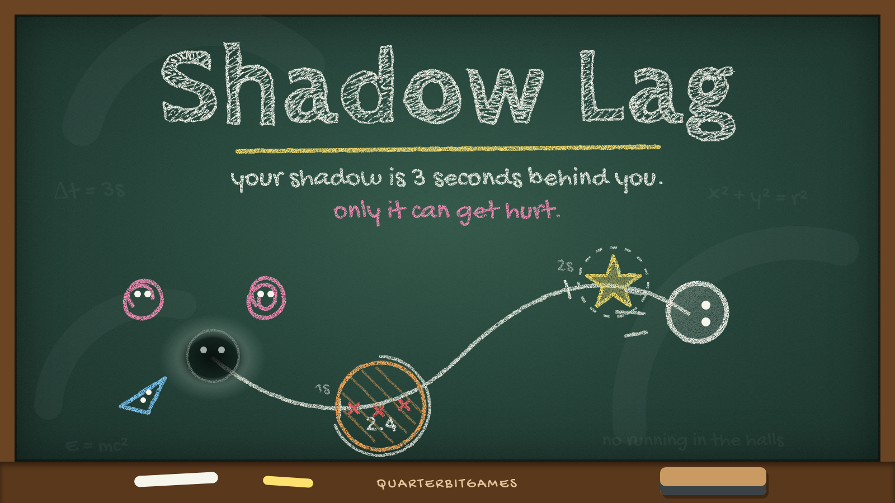

# Shadow Lag

*A QuarterbitGames original.*

Your shadow follows you **3 seconds behind**, and it's the only part of you that can get hurt.
It's also the only part that can grab stuff. You aren't dodging where you are. You're dodging where you *were*.

Everything is drawn in chalk. You leave a chalk line as you move, and your shadow erases it as it follows along that line.

## How to play

- Walk over a **★**. Your shadow picks it up when it gets there.
- **Enemies** pass right through you. They only hurt your shadow, so dash into them to shove them off your trail.
- **Orange chalk zones** hurt your shadow while they're active. The number inside is how many seconds the zone has left. If it runs out before your shadow arrives, you can walk straight through.
- **Red X marks** show up on your trail where your shadow is *going* to get hit.
- **Giant erasers** sweep across the board after a red warning lane.
- **Erase** wipes out your trail, and your shadow snaps back to you. Use it when your past is doomed.
- Each level makes the lag longer, up to 6 seconds.

## Controls

| Action | Gamepad | Keyboard |
|---|---|---|
| Move | Left stick / D-pad | WASD / Arrows |
| Dash (shove) | A · RB · RT | Space · J |
| Erase trail | B · LB · LT | Shift · K · E |
| Pause | Start | Esc · P |
| Menus | Stick / D-pad + A | Arrows + Enter |
| Music on/off | Select / Back | M |

You'll get rumble if your controller supports it.

## Run it

It's one file, `index.html`. Open it in a browser and play. No build step, no dependencies (it uses Google Fonts if they're reachable).

## Music

**"Three Seconds Behind"** (`audio/three-seconds-behind.mp3`) loops in the background. Browsers only allow audio after you interact, so it starts on your first key press or click. It gets quieter when you pause or lose, and your mute setting is remembered.

## Art

In `art/`: `cover.png` (1600×900 key art), `banner.png` (920×430 store banner), and `icon-1024/512/256/128/64.png` (app icon with transparent rounded corners).
